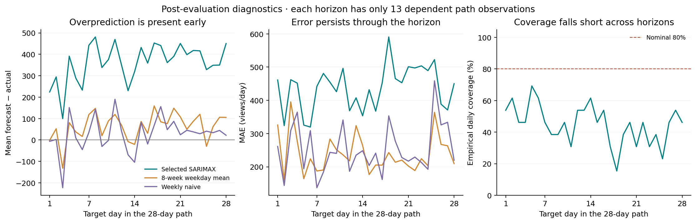
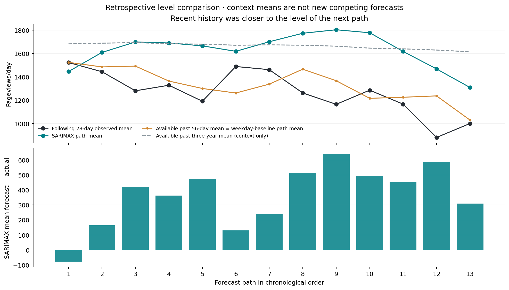

# Retrospective forecast-failure analysis

This is Phase 3 diagnosis of already generated predictions and observations.
No new model is fitted, no path is dropped, no bias adjustment is scored, and
no setting, history window, winner or interval radius changes. Error sign is
**forecast minus actual**, so a positive error means overprediction.

## Direct observations

SARIMAX overpredicts on **326/364 days (89.56%)** and underpredicts on 38.
Mean signed error is **+361.91** views/day; median signed error is **+425.04**.
Mean actual is **1,267.36**, versus mean prediction **1,629.27**. Absolute mean
error is 437.78. The ratio of signed mean error to MAE is 0.827, a descriptive
sign-balance measure, not a percentage of error causally explained by bias.

The ten largest errors account for only **6.11%** of total absolute error;
the largest 28 account for **14.90%**. The observed failure is broad and does
not depend on deleting a handful of spikes. These are concentration summaries,
not alternative evaluation populations. The primary 364-day score is unchanged.

## Horizons and paths

| horizon_week | mae | bias_forecast_minus_actual | coverage |
|---|---|---|---|
| 1.0 | 397.97 | 281.94 | 0.549 |
| 2.0 | 426.75 | 366.15 | 0.462 |
| 3.0 | 466.03 | 412.41 | 0.374 |
| 4.0 | 460.35 | 387.12 | 0.407 |

The first forecast week is already biased high. Later weeks generally have
larger error, but the pattern is not monotonic. Each individual horizon has
only 13 observations. Every issue is a Sunday, so horizon modulo seven also
fixes target weekday: a jagged horizon profile cannot isolate forecast aging
from weekday or particular calendar events. Seven-day summaries balance
weekdays, but still do not identify a causal horizon effect.

| origin_id | actual_mean | prediction_mean | bias_forecast_minus_actual | mae | coverage |
|---|---|---|---|---|---|
| final_01 | 1522.89 | 1445.60 | -77.29 | 248.09 | 0.82 |
| final_02 | 1443.89 | 1609.44 | 165.54 | 370.40 | 0.68 |
| final_03 | 1280.46 | 1699.18 | 418.71 | 422.59 | 0.39 |
| final_04 | 1328.07 | 1690.51 | 362.43 | 441.30 | 0.36 |
| final_05 | 1190.93 | 1665.69 | 474.76 | 482.15 | 0.32 |
| final_06 | 1488.71 | 1618.91 | 130.19 | 219.52 | 1.00 |
| final_07 | 1461.68 | 1700.99 | 239.31 | 301.37 | 0.86 |
| final_08 | 1262.04 | 1773.69 | 511.66 | 511.66 | 0.18 |
| final_09 | 1164.50 | 1803.69 | 639.19 | 666.43 | 0.18 |
| final_10 | 1285.64 | 1778.18 | 492.54 | 568.52 | 0.18 |
| final_11 | 1166.21 | 1618.23 | 452.02 | 523.42 | 0.25 |
| final_12 | 880.57 | 1467.77 | 587.20 | 587.20 | 0.00 |
| final_13 | 1000.11 | 1308.64 | 308.53 | 348.45 | 0.61 |

Twelve of thirteen paths have a positive mean error. Paths 8 and 12 overpredict
every day; path 12 has zero interval coverage. Path 9 has the largest MAE,
666.43. Path 6 has the smallest MAE, 219.52, and 100% coverage. This is a
changing forecasting difficulty, not thirteen independent replications.



## What the recent baselines did differently

With 28 targets containing four of each weekday, the weekday-average baseline's
path mean equals the available past 56-day mean exactly. This observed recent
level is closer to the next path's observed mean than SARIMAX's path mean on
**12/13 paths**. That is a direct property of the saved forecasts and history,
not an ablation showing that a specific model feature caused the error.

For the June 14 issue, SARIMAX averages 1,803.69, while the prior 56 days average
1,366.93 and the next 28 days average 1,164.50. For September 6, those values
are 1,467.77, 1,236.82 and 880.57. The baseline also misses a falling level,
but by substantially less. It is not perfect adaptation.

Across the final period, weekday-mean signed error is +63.75 and weekly-naive
signed error +28.44. Weekly naive has lower absolute error than weekday mean
on 7/13 paths, despite higher aggregate MAE (251.85 vs 238.73) and RMSE (359.83
vs 308.37). Smoothing several weeks helps on some origins; very recent levels
help on others. The experiment cannot isolate recency from smoothing or the
weekday pattern, because it contains no matched nonseasonal recent-mean ablation.
We do not introduce one after final evaluation.



## Conditions and unusual dates

Post-evaluation, target-defined strata show the extent of the level mismatch:
on the 68 days with actual counts below 1,000, SARIMAX MAE is 601.11, weekday
mean MAE 294.57 and weekly-naive MAE 132.13. On the ten days at or above 2,000,
all three underpredict and SARIMAX MAE is lower than the weekday mean's
(764.72 vs 966.09). These thresholds were chosen for readable descriptive
strata after evaluation. They are not predictors, selection criteria, repaired
populations or evidence that a forecaster could know which method to switch to.

The largest absolute error is November 30, 2025: 2,927 observed versus 1,568.82
predicted. That date is in the unrepaired global incident month; article-specific
influence is unknown. July 24, 2026 has 2,696 observed versus 1,753.88 predicted
and coincides with a documented streaming edition. Low observed days in July
also create large errors in the opposite direction. Musical coincidence cannot
explain the whole signed-error pattern.

## Saved dynamics: evidence, hypothesis and limits

The actual specification is regression with SARIMA errors, consistent with
[statsmodels' formulation](https://www.statsmodels.org/v0.14.4/examples/notebooks/generated/statespace_sarimax_stata.html)
and the installed 0.14.5 source:

```text
y[t] = Fourier[t]' beta + u[t]
(1 - phi B)(1 - B^7) u[t] = (1 + theta B)(1 + Theta B^7) epsilon[t]
```

**Observed:** all thirteen fits report convergence, with no fallback. The
seasonal MA coefficient Theta ranges from −0.999986 to −0.999544. Its seasonal
MA polynomial therefore lies close to the differencing polynomial. AR and MA
roots of the modeled ARMA part remain outside the unit circle; this does not
make the integrated raw series stationary. Poorly conditioned covariance
matrices were reported in development; raw condition numbers are unit-dependent,
so their magnitude alone is not proof of nonidentification.

**Algebraic diagnostic:** subtracting the saved Fourier contribution from each
saved forecast leaves a path-mean remainder within about 0.04–61.74 views below
its three-year training mean. The calendar component's path mean ranges from
−244.64 to +171.76. For the June 14 issue it contributes +171.76 on top of a
remainder of 1,631.93. No clipping is active in these selected point forecasts.
This describes the issued forecast's components; it is not a new Fourier-free
forecast or its score.

**Plausible hypothesis:** near cancellation of the seasonal difference and MA
polynomials, together with the fitted persistent level and calendar component,
is consistent with forecasts staying close to a higher historical level while
recent observed traffic is lower. At the exact limiting coefficient −1 the
formal polynomials share a factor; finite-sample state initialization and
estimated coefficients prevent treating that limiting algebra as a proven
explanation of the actual forecast failure. Ordinary AR decay alone does not
describe the full seasonal integrated system.

The pre-selection weekly-differenced series has lag-seven ACF approximately
−0.477 (independently recalculated from the same EDA sample). A stationary
component differenced at lag seven can itself acquire an MA factor near
1−B^7. Overdifferencing is therefore another plausible reading of the boundary
estimate, not a demonstrated diagnosis. Every SARIMAX candidate in the frozen
grid used seasonal D=1; the study did not compare D=0. Neither the ACF nor the
ADF/KPSS results prove that changing D would have won on the final year, and
no such model is fitted here.

**Unresolved:** whether boundary optimization, level changes, calendar
misspecification, skew-sensitive estimation or their interaction explains the
lost comparison. No counterfactual re-estimation was performed. Correct code
and reported convergence do not establish appropriate model assumptions, a
global optimum or a causal mechanism. Neither the boundary estimate nor a
generic label such as overfitting is a sufficient explanation by itself.

## Why the interval undercovers

The unchanged symmetric radius is 408.29. With no lower-bound clipping here,
coverage is exactly the proportion whose absolute error is at most that radius.
Only 163 days satisfy it. Of 201 misses, 190 (94.53%) fall below the lower bound
and 11 above the upper bound: substantial overprediction, not balanced tail
misses, dominates. Coverage is low across horizons and varies 0–100% by path.

This establishes failure of the fixed development error band on this final
period. Calibration reuse, dependence, horizon pooling and changing conditions
are reasons not to expect a general guarantee; their separate causal
contributions to undercoverage are not identified. The radius is not updated.
The predeclared November mask leaves 335 dates, 41.79% coverage and the same
ranking, so the failure is not confined to the omitted November target days.
That mask does not remove November values from later training.

Detailed evidence: [horizons](../../../results/diagnostics/horizon_diagnostics.csv),
[paths and levels](../../../results/diagnostics/path_level_diagnostics.csv),
[saved dynamics](../../../results/diagnostics/saved_dynamics_diagnostics.csv),
[concentration](../../../results/diagnostics/error_concentration.csv),
[outcome strata](../../../results/diagnostics/outcome_strata_descriptive.csv).
