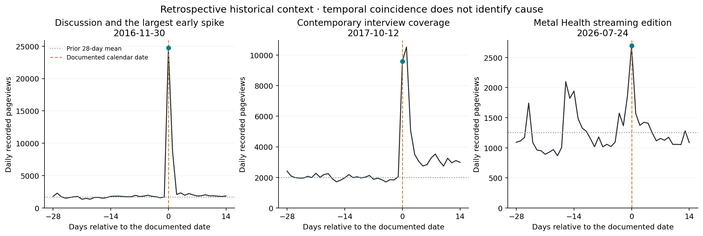

# Buckethead historical interpretation — post-evaluation research

This supplement was researched after final evaluation under the user's Phase 3
authorization. It does not amend the frozen 23-entry ledger, upgrade historical
availability categories, add model covariates, or revive the failed predictive
event gate. Its examples are illustrative, selected and noncausal.

Five dated windows are examined: the largest early spike, a documented interview
coverage period, the two contrasting release examples already in the notebook,
and the previously ledgered final streaming date E17. This mixes outcome-selected
and source-led cases; it is not a random sample of activity. The window rule
is descriptive: the documented date through six days afterward, compared with
the preceding 28 days. Daily counts have UTC boundaries; source dates generally
have calendar-day precision, not verified UTC publication times.

| case | date | count | prior28_mean | following7_mean | following7_over_prior28_mean |
|---|---|---|---|---|---|
| Largest pre-selection day / online discussion | 2016-11-30 | 24744 | 1718.46 | 6313.71 | 3.674 |
| Coming Alive contemporary coverage | 2017-10-12 | 9580 | 2000.86 | 5328.43 | 2.663 |
| Dreams Remembered | 2022-07-05 | 2471 | 1636.29 | 2252.29 | 1.376 |
| Sea Above The Sky | 2024-01-27 | 1815 | 2357.36 | 1581.86 | 0.671 |
| Metal Health streaming edition | 2026-07-24 | 2696 | 1253.46 | 1548.57 | 1.235 |

## November 30, 2016: a discussion record beside the largest spike

**Documented:** an [r/Music discussion](https://www.reddit.com/r/Music/comments/5fomuh/buckethead_has_released_269_studio_albums_with/)
about Buckethead's prolific output directly links the canonical Wikipedia
article and its discography. The thread appears in Reddit's
[November 30, 2016 daily archive](https://www.reddit.com/posts/2016/november-30-1/global/).
This verifies a discussion record on the displayed archive date, not the
headline's numerical album claims, which are not adopted as discographic facts.

**Observed:** 24,744 pageviews on November 30, the largest day in the protected
early history; preceding 28-day mean 1,718.46. Following seven-day mean is
6,313.71, 3.674 times the prior mean.

**Association/hypothesis:** a discussion that links Wikipedia supplies a
plausible referral channel. It does not prove that this thread generated the
spike: exact UTC posting time, original versus edited content, intraday ordering
and referral counts are unavailable. Current votes are not contemporaneous
exposure counts. The causal explanation remains unresolved. The unchanged
notebook's statement that its frozen musical ledger does not establish a cause
remains correct.

## October 2017: an interview and dated contemporary coverage

**Documented:** the [podcast publisher](https://www.thetoolsbook.com/blog/a-conversation-with-buckethead)
describes Barry Michels' Coming Alive conversation with Buckethead. A
[contemporary Loudwire report dated October 12, 2017](https://loudwire.com/buckethead-life-threatening-heart-condition/)
discusses the interview, establishing that it was public by then. A
[podcast listing](https://www.listennotes.com/podcasts/coming-alive/a-conversation-with-buckethead-9jrG3mSnNuR/)
gives October 10, but the original RSS timestamp was not independently recovered.
The publisher's current blog index carries an August 25, 2022 page date; it
must not be mistaken for the original interview's publication date.

**Observed:** 9,580 views on October 12 and 10,526 on October 13. The prior
28-day mean before the coverage date is 2,000.86; the following seven-day mean
is 5,328.43 (2.663 times). The two-day elevated period overlaps documented
public discussion of the interview.

**Limit:** this is an interview/news context, not evidence of an album-release
effect, and it is not a present-day medical assessment. We have no individual
referral data, untreated control series or defensible causal counterfactual.
Other simultaneous exposure remains possible. We make no claim about how the
artist or listeners felt, why individuals visited, or which outlet drove visits.

## Existing release examples: different attention directions

The artist's pages list [Dreams Remembered](https://bucketheadpikes.bandcamp.com/album/dreams-remembered)
on July 5, 2022 and [Sea Above The Sky](https://bucketheadpikes.bandcamp.com/album/sea-above-the-sky)
on January 27, 2024. These independently checked edition dates agree with E12
and E16. They establish no earlier announcement date.

The same calculations as the notebook yield following/prior mean ratios of
1.376 and 0.671. The contrast is useful precisely because a dated release does
not guarantee a larger measured audience. It does not show that one release
increased attention while another reduced it. These examples were already
selected for their contrasting descriptive patterns, not sampled independently;
overlap, source coverage, background levels and other activity are uncontrolled.

## July 24, 2026: the previously ledgered Metal Health edition

**Documented:** [Apple Music](https://music.apple.com/us/album/metal-health/6767608272)
lists Bootsy Collins and Buckethead's sixteen-track Metal Health with a July 24,
2026 release date, corroborating E17's
[Spotify edition](https://open.spotify.com/album/06uVHb5vadazfMziLqyljm).
This is a streaming edition date, not proof of the first announcement, recording
date, or earliest appearance on every platform.

**Observed:** the canonical article has 2,696 views that day, the second-highest
day in the final period. That is 2.151 times the preceding 28-day mean (1,253.46).
The following seven-day mean is 1,548.57, a 1.235 ratio. The selected fixed-origin
forecast, issued July 12 using counts through July 10, was 1,753.88 for July 24.
It underpredicted this day, despite overpredicting much of the surrounding year.

**Association, not mechanism:** the dates coincide at calendar-day precision.
There is no control for the surrounding publicity or other events, and E17
remains category B: no verified advance-availability upgrade is made. This
cannot retrospectively justify adding the release as a predictor or explain
the selected model's broad overprediction on 326 final days.

## What remains unexplained

The largest final-period day, November 30, 2025 (2,927), is not assigned a
musical cause. It lies in the documented
[unrepaired Wikimedia incident month](https://wikitech.wikimedia.org/wiki/Data_Platform/Data_Lake/Data_Issues/2026-06-10_Nov_2025_spike_in_bot_traffic),
which is also not proof that this particular article/date is bot-contaminated.
Other peaks and the later lower traffic level remain causally unexplained.
This bounded research did not reconstruct a complete concert/release/announcement
calendar and makes no absence-of-activity claims.

The [source register](../../../provenance/sources/diagnostic_sources.json) records primary versus secondary
evidence, precise claim scope, date limitations and failed source access. These
new interpretive notes never enter the original modeling ledger. Safe article
language is “coincided with,” “was documented by,” and “is consistent with a
possible channel”; “caused,” “generated these views,” and unmeasured audience
motives are unsupported.
