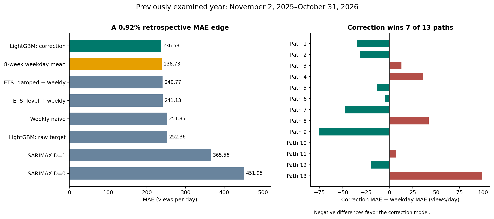
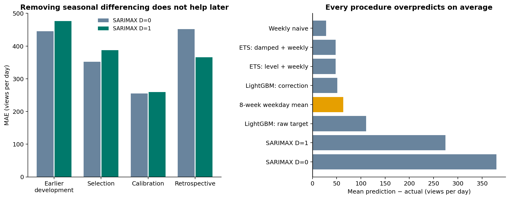
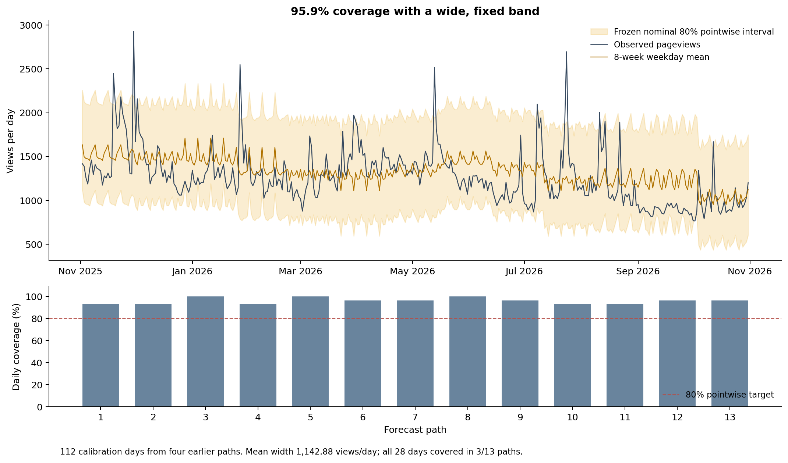

# Phase 4 findings — From Pikes to Pageviews

Completed November 5, 2026. **The bounded extension found no convincing, meaningful improvement over the eight-week weekday baseline.** The correction LightGBM has the lowest retrospective MAE, 236.53 versus 238.73 views/day, a 0.92% gain. It has worse RMSE, wins only 7/13 paths, and its MAE advantage falls to 0.06% under the predefined November sensitivity. The 10% aspiration was not reached. The development-selected procedure remains the weekday baseline; the correction model is an exploratory challenger for future observation.

All six specified candidates and both baselines were completed. There were 216 real-data candidate fits, 72 baseline paths, 8,064 predictions and **zero fitting failures/fallbacks**. The stopping rule is reached. No extra model, feature, history-window or interval variant was tried. Phases 0–3, including the original final notebook, are unchanged.

## 1. What this evidence can establish

The active [protocol v2](../../../provenance/protocols/retrospective_followup/PROTOCOL_V2.md), [schedule](../../../provenance/protocols/retrospective_followup/schedule_v2.csv), [roster](../../../provenance/protocols/retrospective_followup/candidates.json) and implementation were frozen before real-series fitting. This is retrospective research on history already inspected in earlier phases. Local timestamps and hashes establish the recorded sequence and integrity; they do not provide external preregistration or restore an untouched test set.

At issue O, all inputs end at C=O−2. Each issued path contains 28 fixed daily predictions, without updates inside that path. ETS/SARIMAX predict the intervening unavailable day as well: 29 predictions, discard the first. Historical ML training paths must have all labels mature by C. The common weekly MASE denominator uses observed seven-day differences wholly inside (C−3 calendar years,C]. Signed errors below mean prediction−actual.

| Role | Target dates | Paths | Days per procedure |
|---|---|---:|---:|
| Earlier development diagnostics | 2023-11-05–2024-10-05 | 12 | 336 |
| Point selection | 2024-11-03–2025-05-17 | 7 | 196 |
| Interval calibration | 2025-06-15–2025-10-04 | 4 | 112 |
| Retrospective comparison | 2025-11-02–2026-10-31 | 13 | 364 |

**One pre-fit correctness amendment:** the first preflight found that the original eighth selection path's final label, June 14, would be unavailable at the June 15 calibration issue's June 13 cutoff. Before any real candidate fit or new candidate score, that path became an unscored boundary block. All four calibration paths, the candidate set and the retrospective period stayed fixed. The original freeze, failed preflight and source versions remain in [amendment 01](../../../provenance/protocols/retrospective_followup/AMENDMENT_01.md) and its archive. The corrected preflight passed before the implementation lock.

## 2. Development and selection

MAE, views/day; each column uses its own fixed chronological dates. Calibration scores are reported for transparency and were not used to change point selection.

| Procedure | Earlier development | Selection | Calibration | Retrospective |
|---|---:|---:|---:|---:|
| Eight-week weekday mean | 548.57 | **318.01** | 354.07 | 238.73 |
| Weekly naive | 863.05 | 423.48 | 462.41 | 251.85 |
| ETS(A,N,A) | 753.73 | 423.66 | 462.76 | 241.13 |
| ETS(A,Ad,A) | 754.51 | 423.42 | 462.70 | 240.77 |
| SARIMAX D=0, standardized | 445.05 | 352.08 | 255.15 | 451.95 |
| SARIMAX D=1, standardized | 476.74 | 387.23 | 259.27 | 365.56 |
| LightGBM raw control | 467.03 | 324.53 | 320.04 | 252.36 |
| LightGBM correction | 488.30 | 330.14 | 395.31 | **236.53** |

The baseline won the seven-path point-selection rule. Its identity was saved before calibration scoring and remained fixed. The correction model lost to the raw control in all three earlier stages; its later ranking is period dependent. Earlier-development performance was diagnostic, with no tuning or candidate replacement.

## 3. Retrospective performance and paired comparisons

Primary population: all 364 days. MASE values use the same origin-specific denominator across procedures. Overprediction counts strict prediction>actual, including no ties as overpredictions.

| Procedure | MAE | RMSE | MASE | Mean signed error | Overprediction |
|---|---:|---:|---:|---:|---:|
| LightGBM correction | **236.53** | 312.22 | **0.5657** | +51.24 | 67.3% |
| Eight-week weekday mean | 238.73 | **308.37** | 0.5699 | +63.75 | 68.4% |
| ETS(A,Ad,A) | 240.77 | 322.45 | 0.5756 | +47.71 | 62.6% |
| ETS(A,N,A) | 241.13 | 322.94 | 0.5764 | +47.98 | 62.6% |
| Weekly naive | 251.85 | 359.83 | 0.6018 | +28.44 | 55.8% |
| LightGBM raw control | 252.36 | 312.31 | 0.6065 | +110.58 | 74.7% |
| SARIMAX D=1, standardized | 365.56 | 418.33 | 0.8709 | +274.45 | 86.8% |
| SARIMAX D=0, standardized | 451.95 | 505.07 | 1.0845 | +379.91 | 89.8% |

The correction saves **2.20 views/day MAE** against the main benchmark, while RMSE worsens by 3.86. A 10% gain would require MAE ≤214.86 on these dates. Improvement over the original SARIMAX is insufficient evidence of improvement over a credible reference.

Paired per-path MAE differences below are candidate−baseline; negative favors the candidate. These are descriptive comparisons of dependent paths, not independent trials or significance tests.

| Candidate versus weekday mean | Paths won | Pooled difference | Median path difference | Best / worst path difference |
|---|---:|---:|---:|---:|
| LightGBM correction | 7/13 | −2.20 | −4.74 | −75.63 / +99.06 |
| LightGBM raw | 6/13 | +13.62 | +6.54 | −72.77 / +130.25 |
| ETS(A,Ad,A) | 8/13 | +2.03 | −7.37 | −278.27 / +248.93 |
| ETS(A,N,A) | 8/13 | +2.40 | −7.35 | −278.26 / +252.53 |
| SARIMAX D=0 | 2/13 | +213.22 | +263.71 | −44.70 / +359.95 |
| SARIMAX D=1 | 3/13 | +126.83 | +114.56 | −39.66 / +319.40 |

Against weekly naive, the correction wins 7/13 paths and lowers pooled MAE by 15.32 views/day (6.08%); median path difference is −3.33. Winning more paths does not necessarily minimize pooled error: ETS wins eight paths against the main baseline but loses in aggregate. Complete paired differences against **both** baselines for every stage and path are in [paired_differences.csv](../../../results/retrospective_followup/paired_differences.csv); [paired_stability.csv](../../../results/retrospective_followup/paired_stability.csv) summarizes their distribution.

The correction and baseline have their worst path MAEs at the September 6, 2026 issue: 336.67 and 356.25 respectively. For the correction, horizon-specific MAEs range from 169.38 to 408.17; for the baseline, 158.46 to 395.51. Each horizon has only 13 observations. Because every issue is Sunday, horizon modulo seven is tied to weekday; the table cannot isolate a causal effect of forecast distance. Full [origin](../../../results/retrospective_followup/origin_metrics.csv) and [horizon](../../../results/retrospective_followup/horizon_metrics.csv) results are retained, including bias and overprediction frequency.

### Predefined November sensitivity

This excludes November 2025 **target scores only**, retaining exactly the same forecasts and fits. There are 335 daily scores across 12 remaining paths: one has 27 dates, the others 28. Daily pooling avoids overweighting that partial path.

| Procedure | MAE without November 2025 |
|---|---:|
| LightGBM correction | 230.926 |
| Eight-week weekday mean | 231.057 |
| ETS(A,Ad,A) | 235.316 |
| ETS(A,N,A) | 235.715 |
| LightGBM raw | 244.909 |
| Weekly naive | 249.155 |
| SARIMAX D=1 | 372.206 |
| SARIMAX D=0 | 466.298 |

The correction's advantage is just **0.131 views/day, or 0.0569%**, with 6/12 path wins. Masked MASE even slightly favors the baseline (0.5534 versus 0.5541), because its origin scaling weights errors differently. This is a fragile ranking. The mask addresses a previously documented Wikimedia-wide traffic incident; Buckethead-specific contamination is unknown. It does not repair the target or remove affected observations from later training. See the original [Wikimedia incident record](https://wikitech.wikimedia.org/wiki/Data_Platform/Data_Lake/Data_Issues/2026-06-10_Nov_2025_spike_in_bot_traffic) and the preserved Phase 3 source audit.

## 4. Controlled seasonal-differencing investigation

Both new SARIMAX procedures use three-year training histories, (1,0,1) nonseasonal order, seasonal MA(1), annual Fourier K=2, identical estimation rules and the same training-only level transform z=(y−mean)/population_std, inverted to count units. D=0 receives a defensible nonzero traffic level. D=1 has the same affine treatment without introducing a separate drift or unidentified constant. The controlled intervention is seasonal differencing within this specified pair.

D=0 has lower MAE in earlier development (−31.68 versus D=1), selection (−35.15) and calibration (−4.12). On the retrospective period it has **higher** MAE by 86.39, losing 8/13 paths to D=1. Removing differencing did not resolve the later failure. Neither specification is close to the main baseline on that year.

All 72 SARIMAX fits converged and were finite. In the 13 retrospective D=1 fits, seasonal MA coefficients range from −0.999847 to −0.959372; minimum MA root moduli range from 1.00002185 to 1.00594272. Near-boundary behavior persists. D=0 roots are comfortably outside the unit circle (minimum MA moduli 1.5453–1.6039), yet its forecasts are worse. Numerical root distance alone is not a forecasting selection criterion, and convergence does not establish a global optimum.

The original unchanged SARIMAX MAE was 437.78; the new D=1 has 365.56. That historical contrast changes numerical scaling/level treatment and estimation budget and was not a controlled D experiment. It cannot establish that standardization, optimizer iterations or seasonal differencing alone caused the improvement. The original near-cancellation diagnosis remains a plausible explanation to investigate, not a demonstrated cause of failure or a proven prescription to use D=0.

## 5. Does LightGBM learn useful baseline corrections?

The pair shares expanding history, all 17 original features, row ordering, 300 trees, seven leaves, L1 loss, random seed 42 and all other hyperparameters. X, raw-label and origin-baseline hashes match at every one of the 36 issues. For each historical training issue S, the correction label is y[target]−b_S[target weekday], where b_S uses only the last 56 observations through S−2. No later issue's baseline enters those labels. Full training paths end by the evaluation cutoff; negative correction labels are retained.

The independent verifier reconstructed all 36 pairs' training labels and offsets directly from raw counts. The raw-target control also matches the original expanding LightGBM **exactly on 644 shared daily predictions**, supporting comparability despite the repaired clean environment.

On the retrospective year, correction training reduces MAE by 15.82 versus raw-target training (6.27%), winning 8/13 paths. Against the stronger weekday reference, however, the gain is only 2.20. Its average absolute adjustment to that reference is 81.04 views/day, with mean adjustment −12.51. Adjustments improve absolute error on 174 days and worsen it on 190; their magnitudes produce the small positive pooled result. They reduce mean overprediction, but 67.3% of forecasts still overpredict.

The correction is worse than the raw control on earlier development, selection and calibration; it loses all four calibration paths to raw-target training. Therefore **some useful adjustments on this later period** is supported; **a reliably superior residual-learning strategy** is not. No feature-importance causal interpretation or post-hoc feature selection is used. [Baseline corrections](../../../results/retrospective_followup/baseline_corrections.csv) and [controlled comparisons](../../../results/retrospective_followup/controlled_comparisons.csv) retain the unfavorable results.

## 6. ETS, bias and numerical diagnostics

Both adaptive-level ETS specifications approach the baseline retrospectively but do not beat its MAE or RMSE. The damped-trend arm changes MAE by only −0.37 versus the level-only arm. Retrospective level smoothing is about 0.26–0.29 in both; seasonal smoothing is very small, about 0.000071–0.000074. The damped arm's trend smoothing is also small. These are fitted properties of this weekly additive specification, not evidence that all adaptive smoothing or trend models are ineffective.

Every procedure has positive retrospective mean signed error. ETS reduces average bias relative to the weekday baseline but still has higher absolute error. Lower bias alone does not imply better forecasts. Both SARIMAX arms overpredict substantially more often and by larger amounts. No post-evaluation bias correction was applied.

Across all 216 real-data fits, there were no nonconvergence events, fallback forecasts or nonfinite outputs. Thirteen recorded Python warnings all come from Pyparsing deprecations during the first LightGBM import; they are not optimizer failures. Library convergence flags are reported as such, without claiming unique parameter identification or cross-platform numerical invariance. All parameters, returned optimizer diagnostics, transformations, roots and warnings are retained in [fit_audits.json](../../../results/retrospective_followup/fit_audits.json) and [numerical_diagnostics.csv](../../../results/retrospective_followup/numerical_diagnostics.csv).

## 7. Frozen prediction intervals

The selected point procedure and requested baseline are the same model, so the frozen comparison correctly deduplicates them. **Only the weekday baseline has evaluated Phase 4 intervals.** The retrospectively nominated correction model does not inherit this coverage result.

The four earlier calibration paths supply all 112 signed errors r=actual−prediction. One-indexed ranks 11 and 102 give offsets **−518.375 and +624.5** views/day, without interpolation. For every retrospective prediction p, bounds are [max(0,p−518.375), max(0,p+624.5)]. Quantiles stay fixed across all issues. No retrospective width adjustment or alternate calibration variant was evaluated.

| Population | Days | Pointwise coverage | Mean width | Below / above misses | 80% interval score |
|---|---:|---:|---:|---:|---:|
| All retrospective dates | 364 | **95.88%** | 1,142.88 | 2 / 13 | 1,252.95 |
| Exclude November 2025 scores | 335 | **96.42%** | 1,142.88 | 2 / 10 | 1,229.51 |

Interval score is width plus 10 times each out-of-band distance; lower is better. These nominal 80% intervals are **too conservative on the observed period**. High coverage accompanied by a wide band is not evidence of accurate 80% calibration. Calibration MAE (354.07) exceeds later baseline MAE (238.73), consistent with a less volatile later error distribution; this is a descriptive explanation, not a causal test.

Daily coverage by path is 92.86%–100%. All 28 dates are covered in only 3/13 complete paths (23.08%); under the mask, 3/11 complete paths (27.27%), excluding the partial path from this separate statistic. Pointwise and simultaneous path coverage are different quantities. [Interval metrics](../../../results/retrospective_followup/interval_metrics.csv) also contain all 28 horizon-specific coverage, width, misses and score rows for each population.

Only four calibration paths, within-path dependence, earlier research exposure and changing traffic conditions limit inference. No distribution-free or conditional coverage guarantee is claimed. The original SARIMAX's 44.78% coverage and these new baseline intervals change **both the point procedure and calibration method**; their difference cannot isolate a calibration-method improvement. We do not add an unplanned comparison to obtain that attribution.

## 8. Reproducibility and verification

The entire real-data experiment ran in a freshly created isolated Python 3.10.18 environment: NumPy 1.26.4, pandas 2.3.3, SciPy 1.15.2, statsmodels 0.14.5, LightGBM 4.6.0, scikit-learn 1.7.2 and Matplotlib 3.10.5. Imported versions match installed metadata. [The resolved lock](../../../provenance/protocols/retrospective_followup/requirements.lock) records all 22 packages; the dependency consistency check passes. This repairs the original environment's metadata/import mismatch. It is a clean Python environment on the existing macOS host, not an independently provisioned OS; native OpenMP may come from that host.

Before fitting, **16 targeted tests passed**, including execution of all six engines on synthetic data and invariance when observations after the cutoff were changed. Tests cover training-label maturity, origin-specific baselines, delayed data, the 29/28-date bridge, SARIMAX level treatment, shared MASE, pooled RMSE, selection rules and exact interval quantiles. The original failed chronology preflight remains preserved.

The independent [verifier](../../../src/research/retrospective_followup/verify_results.py) then checked all 288 records and 8,064 predictions against raw API counts and saved caches. It recomputed 40 population summaries, 384 origin rows, 1,120 horizon rows, 848 paired rows and the interval calculations. All 144 ETS/SARIMAX paths were reconstructed from saved parameters without optimizer fitting; maximum prediction difference was **6.82×10⁻¹²** views. All 36 ML training pairs were independently checked. The earlier raw-control comparison is exact. No additional candidate fitting occurred during verification or reporting.

All **539 protected files** from Phases 0–3 pass their SHA-256 checks. Original final notebook SHA-256 remains `97ca6320c68ef97ddd82dbd7dabffc3f157a703bf5d5521ee8c0d036a8410727`. The final Phase 4 manifest separately freezes the new artifacts. See [verification.json](../../../results/retrospective_followup/verification.json), [preflight.json](../../../results/retrospective_followup/preflight.json), [environment.json](../../../results/retrospective_followup/environment.json) and [reproduction instructions](../../reproducibility.md).

## 9. Recommendation for fresh evaluation

**Retain the eight-week weekday mean as the reference and the development-selected forecasting procedure.** The fixed exploratory nomination rule chooses `lgbm_correction` as one challenger for future observation. Its tiny retrospective advantage does not justify calling it a validated replacement. No additional feature or model search is warranted under the approved stopping rule.

| Planned issue, 00:00 UTC | Latest permitted observation | Target period |
|---|---|---|
| 2026-11-08 | 2026-11-06 | 2026-11-08–2026-12-05 |
| 2026-12-06 | 2026-12-04 | 2026-12-06–2027-01-02 |
| 2027-01-03 | 2027-01-01 | 2027-01-03–2027-01-30 |
| 2027-01-31 | 2027-01-29 | 2027-01-31–2027-02-27 |

Use the unchanged recipes and two-day delay, saving timestamped point forecasts and their exact input snapshots before each target path starts. Later fits may use newly mature observations. Evaluate paired errors after targets mature; retain both favorable and unfavorable paths and preserve revisions to observed API data separately. Four paths are an initial prospective observation period, not a guarantee of adequate power or broad generalization. The correction model has **no evaluated uncertainty method in this phase**; baseline coverage must not be used as its uncertainty claim.

**Current status: zero fresh paths, no future forecasts issued and no scheduled jobs.** The frozen data end October 31. The dates above are a plan, not evidence that predictions have already been saved. Confirmation remains pending.

## 10. Effect on the eventual TDS article

Phase 4 strengthens the methodological story: a carefully checked adaptive-model extension mostly fails to beat a simple benchmark, and an apparently best correction model has a negligible sensitivity-adjusted margin. The article can teach delayed-data evaluation, nonzero-level treatment in matched SARIMAX comparisons, origin-specific residual targets, unstable rankings and interval overcoverage. The bounded search and preserved negative results support the project's credibility.

The defensible scientific claims are the measured scores and protocol behavior on these dates. Explanations involving attention shocks, traffic-level shifts, over-differencing or the benefit of anchoring ML to a baseline remain hypotheses with differing amounts of descriptive support. No result establishes an irreducible error floor, proves that another method cannot improve, or establishes general superiority of simple models.

Buckethead knowledge remains valuable for careful, sourced historical interpretation. The frozen event-availability gate did not support event features; Phase 4 does not backdate release knowledge or interpret release proximity as causality. Canonical-title, user-classified pageviews measure recorded page traffic, not unique people, fandom or verified human attention. Wikimedia revisions and the known global data incident remain part of the story.

Keep the original failed final evaluation and this explicitly labeled retrospective extension distinct. Do not present the latter as a new untouched test, report the small MAE edge without its RMSE and sensitivity limits, or advertise 95.9% coverage as correctly calibrated 80% uncertainty. A substantial forecasting improvement has not been demonstrated. The planned fresh comparison is the next opportunity to assess the challenger honestly. No article draft is included in this phase.
